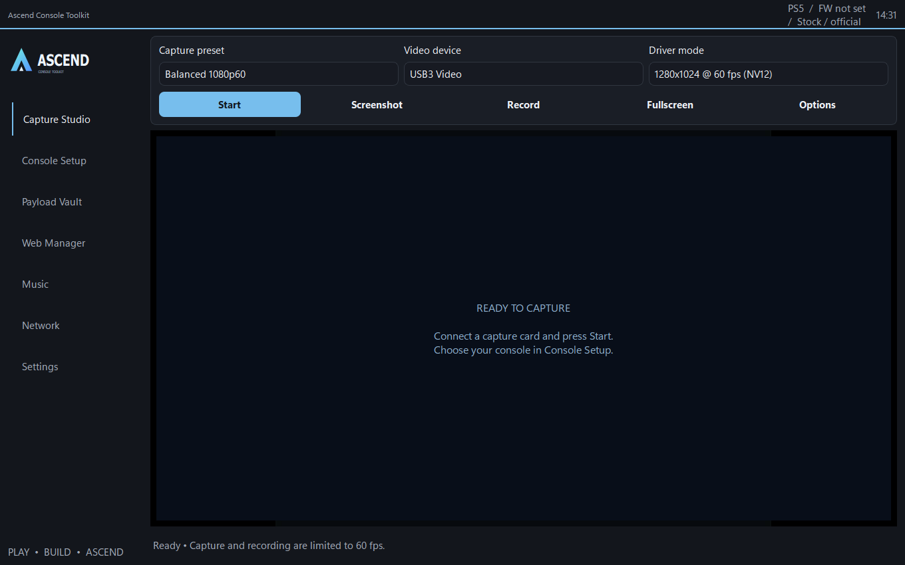
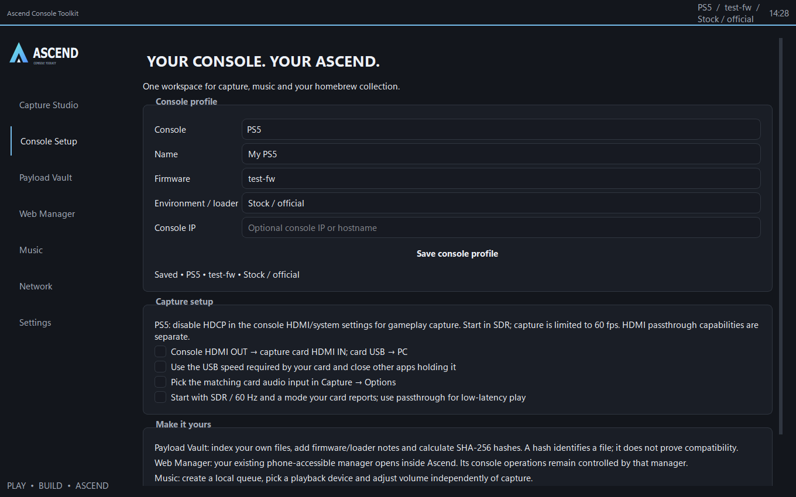
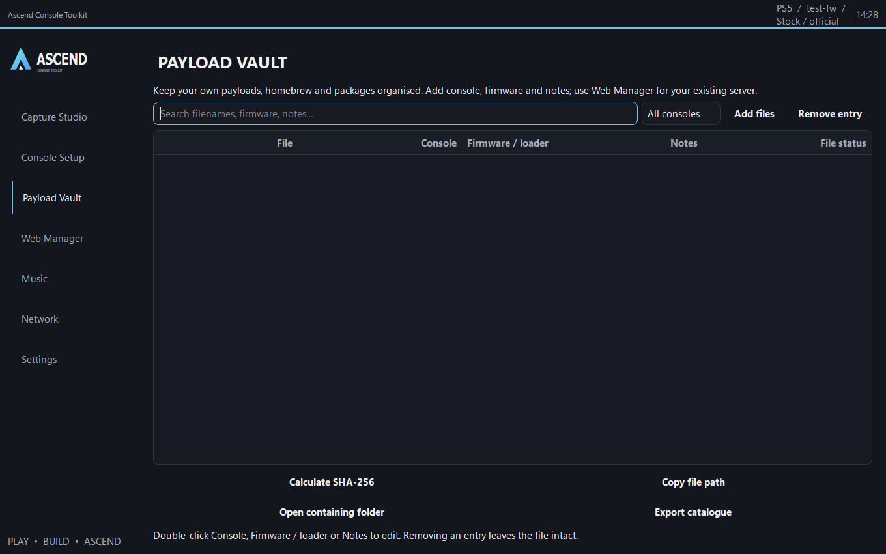
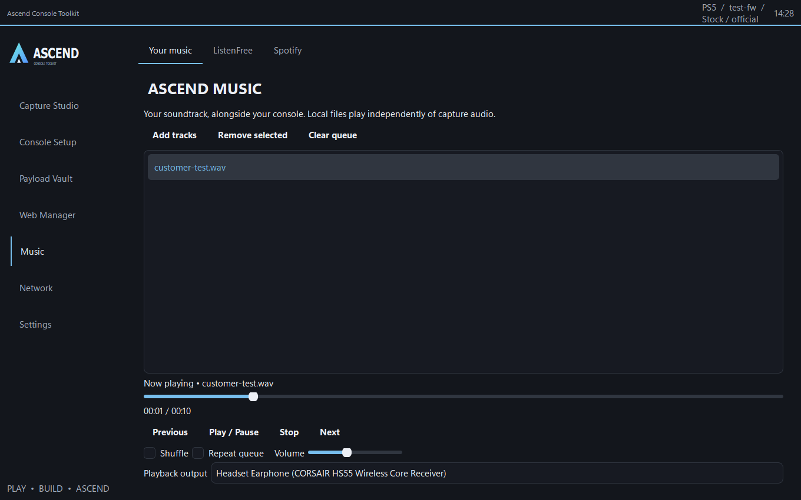

# Ascends PS Capture program

A free Windows desktop toolkit for PlayStation capture and homebrew — console profiles,
capture-card preview and recording, payload organising, a web manager, FTP and music,
all in one clean interface.

Built with Python and PySide6 / Qt.

## Screenshots

| Capture Studio | Console Setup |
| --- | --- |
|  |  |

| Payload Vault | Music |
| --- | --- |
|  |  |

## Download & run

1. Go to the [Releases](../../releases) page and download **AscendToolkit-Windows-EXE.zip**.
2. Extract the ZIP and keep the whole **AscendToolkit** folder together.
3. Double-click **AscendToolkit.exe**.

No Python or extra downloads needed — everything is bundled.

> On first launch Windows may show **"Windows protected your PC"** (SmartScreen), because
> the app isn't code-signed. Click **More info → Run anyway**.

## Features

- **Console profiles** for PS3 / PS4 / PS5 — console, firmware and environment in one place
- **Capture Studio** — live capture-card preview, screenshots, and MP4 recording (up to 60 FPS)
- **Payload Holder** — organise your homebrew files by console, firmware and notes, with SHA-256 and JSON export (references your files, never executes them)
- **Web Manager** — load your console's own web interface inside the app
- **FTP file manager** — browse, upload, download, rename and delete over your console's FTP
- **Music** — local player plus online streaming, independent of capture audio
- **Themes & layout** — Studio default with optional colour themes and lighting

## Requirements

- Windows 10 or 11 (64-bit)
- A capture card with a working Windows driver (for video capture)
- PS4 / PS5 gameplay capture may require HDCP disabled in the console's settings

## Privacy

Settings are stored on your own PC only; the app doesn't send them anywhere.
See [PRIVACY.md](PRIVACY.md) and [THIRD_PARTY.md](THIRD_PARTY.md) for details.

## Build from source

Developers can build the EXE themselves:

```bat
run.bat          :: first run sets up the environment
build_exe.bat    :: produces dist\AscendToolkit\AscendToolkit.exe
```

## License

Released under the [MIT License](LICENSE).
